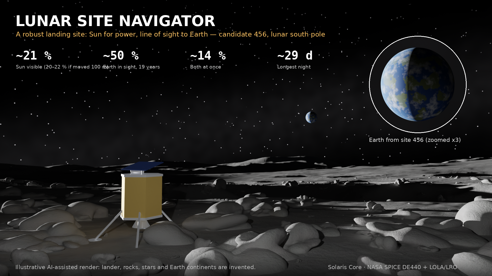
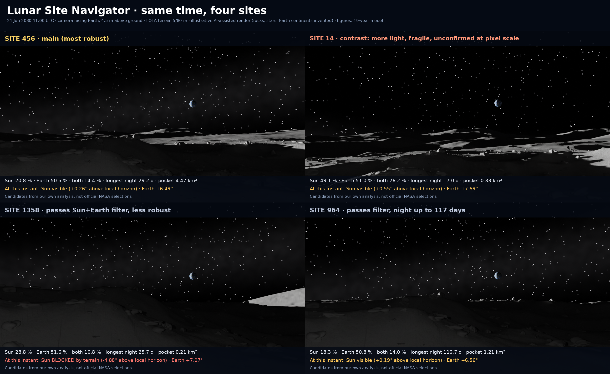

# Lunar Site Navigator



*Illustrative render of site 456, AI-assisted. The lander, rocks, stars and Earth's continents are invented.*

**Live app / App en linea:** https://lunar-site-navigator.rodneymora94965.workers.dev

## English

A single-file web tool for comparing landing sites and dates near the lunar south pole: when there is Sun for power and when there is line of sight to Earth, using precomputed ephemerides and terrain horizons.

Open `final.html`. It needs no server or data download. With a network it loads Google Fonts; offline it uses fallback fonts.

### What it does

- First screen answers whether there is Sun and line of sight at the chosen site and date, when that changes, and when the next window with both opens.
- Window calendar: every arrival day of a year against missions of 1 to 28 days, colored by time with Sun, Earth or both. It uses the planner's own count; it gives no verdict on a date and leaves out temperature, dust and landing risks.
- Compares up to 3 sites side by side on hourly data, 2026-11-01 to 2045-10-31.
- Shows true Sun and Earth elevation, margin above terrain, visible solar disc and time to the next change.
- Applies a minimum Earth elevation of 0°, 3° or 5°.
- Estimates power with a simple model and visible assumptions.
- Delay planner: site, launch date, cruise and duration, with Sun, line of sight, longest night and energy.
- "If I move the lander 100 m" heat map, plus ranges instead of a single figure.
- Custom coordinates from 80°S to 90°S, computed in the browser with a reduced DEM.
- Same site on two dates, side by side, with panoramas and the 30 days after each date.
- Play button that moves through time with the model's data.
- Share link that keeps sites, date and settings, and hourly CSV export of model outputs.
- Representative points in 9 regions NASA names as candidates, in their own group and outside the ranking.

### Method

`src/precalc.py` computes hourly Sun and Earth vectors with SPICE (DE440s, MOON_ME). `src/horizon2.py` traces rays over LOLA elevation toward 360 azimuths out to 200 km, with lunar curvature, no refraction and a 5 m observer. It uses 5 m terrain inside the 16×16 km Site04 tile, 80 m terrain elsewhere and, beyond 304 km from the pole, 120 m terrain. The Sun counts as visible when its disc center is above the horizon. Model energy uses the visible disc fraction.

### Main site and contrast

**Site 456 is the main site: the most robust of the 10 candidates, not the one with the most light.** Sun is 21 % (20–22 when moved ±100 m) and Sun with Earth 14 % (14–15), in a 4.47 km² pocket. Sun is 21 % in the model, 15 % in LROC (2010-2011) and 23 % in PGDA. Its cost is less light and a longer night, 29 days.

**Site 14 is the contrast: more light, but fragile and not confirmed at pixel scale.** Its advantage is more light and more time with Sun and Earth: Sun 49 %, both 26 %, night of 17 days. Its weakness is a 0.33 km² pocket, Sun from 33 to 58 % when moved ±100 m, and PGDA neighbors at 0 %.



*Illustrative render, same time at four sites; the figures are the 19-year model values at each point.*

**Selection criterion:**
1. Filter: Earth of at least 40 % throughout ±100 m, and Sun and Earth together at least 10 % at the point. Sites 456, 14, 1358 and 964 pass.
2. Agreement among model, LROC and PGDA.
3. Narrow range when moved ±100 m.
4. Large pocket.
5. Short night, only as a tiebreaker.

This criterion is our own judgment, set after seeing the data. It is not a NASA requirement.

### Validation

Full summary: `auditoria/validacion/RESUMEN_VALIDACION.md`.

- **Validated:** Sun and Earth positions against JPL Horizons at 20 dates and 3 sites (maximum elevation difference 0.00003°). The horizon code matches synthetic analytic cases. The browser JavaScript matches Python and Horizons.
- **Validated for amount of light:** Sun visibility against the LROC WAC IMG product (`WAC_POLE_ILL_PCT_SOUTH_100M`, February 2010 to February 2011, 100 m/pixel, conservative illumination threshold), with the app's configuration and no calibration factor. 121 Site04 cells: bias −0.3 points, MAE 1.3, r 0.985, slope 1.00.
- **Overestimate in the 10 candidates:** the same comparison gives bias +7.4, MAE 7.4, r 0.90, slope 1.04, so the model gives about 7 points too much light there. These figures should be read as high.
  - *Selection of terrain:* the candidates are the 10 largest flat pockets, not points chosen for light. 40 other flat pockets show +3.9, while 40 random cells show −0.5.
  - *Selection for light:* site 14 was picked out for having the most light and shows +9.9 (model 48.7 %, LROC 38.8 % for 2010-2011). It may inherit a selection effect, but one point cannot prove it.
  - *Resolution:* the model uses a point on 5 m terrain and LROC a 100 m pixel. Averaging the pixel lowers the bias to +6.2. Counting only times when the whole pixel is lit lowers it to +3.5, an extreme case because LROC's threshold cannot be reproduced.
  - *Unexplained:* these effects overlap and do not close the gap.
- **Time and direction of sunlight: passes a test fixed in advance, at 5 dates in 2009.** Five dated LROC WAC frames (`WAC_POLE_MOVIE_SOUTH`, 100 m/pixel), chosen without opening any image, split into light and shadow by an Otsu threshold that does not use the model, and compared with the model at 6,400 Site04 points (200 m grid), with no calibration. MCC (0 = chance, 1 = perfect) by frame: +0.474 (2009-10-22), +0.877 (2009-11-06), +0.815 (2009-11-01), +0.777 (2009-11-16), +0.743 (2009-09-27); mean 0.737 against the required 0.5. In all 5 it beats three controls (mirrored azimuth, Sun turned 180°, date +14.77 days), whose MCC runs from −0.30 to +0.36. See `auditoria/validacion/prueba_fechas_lroc.md`.
- **Validated for amount of Sun and Earth, general terrain:** against NASA PGDA maps (LOLA IMG products, a separate calculation from the same elevation source as our terrain, so an independent method but not an independent measurement; 60 m/pixel, 18.6-year average, label scale, no calibration). With the app's configuration, 121 Site04 cells: Sun bias −0.3 points, MAE 1.6, r 0.965, slope 0.95; Earth bias −1.3, MAE 3.1, r 0.961, slope 0.91. 10 candidates: Sun bias +3.1, MAE 3.8, r 0.946, slope 1.02; Earth bias −2.2, MAE 2.6, r 0.994, slope 0.97.
- **Warning: site 14 is fragile and not confirmed at pixel scale.** It lies about 660 m from the pole. PGDA gives 41.6 % Sun and 55.5 % Earth at its exact pixel; an earlier 0 % was our own geometry error, now corrected. What remains: 8 of the 9 pixels within 100 m read 0 % in PGDA, while LROC shows no zeros (22–46 % within ±300 m) and neither does the model. That speckle is concentrated within about 2 km of the pole and looks like an artifact, but the cause is not established. Moving ±100 m gives 33–58 % Sun, and LROC gives 38.8 % against the model's 48.7 % for 2010-2011.
- **Corrected earlier reading:** a previous validation used the project's reading of the 8-bit browse GeoTIFF as 255 = 100 %. That was wrong: the file is stretched and saturates near 45 %. See `auditoria/validacion/escala_lroc.md`.

### Points in regions NASA names as candidates

Nine points, outside the ranking and in a separate group. Each is one site published by Wueller et al. 2026 (JGR Planets 131(3), e2025JE009434; data at https://doi.org/10.5281/zenodo.17084058, CC BY 4.0): the published site closest to the center of that study's sites in the region. The rule ignores light and was fixed before opening the data. These are not NASA selections, and one point does not describe a whole region. In Mons Mouton Plateau the published sites span about 32 km.

| Region | Published site | Lat, lon | Terrain | Model Sun / Earth | PGDA Sun / Earth | LROC |
|---|---|---|---|---|---|---|
| Peak near Cabeus B | PCB03 | -83.563, -68.2009 | 80 m + 120 m | 55.0 / 77.3 % | Not covered | Not covered |
| Haworth | HW02 | -86.8076, -21.7194 | 80 m + 120 m | 47.7 / 59.4 % | 36.9 / 53.5 % | Not covered |
| Malapert Massif | MMA01 | -85.9425, -0.94365 | 80 m + 120 m | 45.5 / 100.0 % | 45.7 / 100.0 % | Not covered |
| Mons Mouton Plateau | MMP06 | -84.5961, 30.4525 | 80 m + 120 m | 13.1 / 49.2 % | Not covered | Not covered |
| Mons Mouton | MMO01 | -85.416, 31.8506 | 80 m + 120 m | 74.7 / 61.4 % | 73.8 / 60.7 % | Not covered |
| Nobile Rim 1 | NR107 | -85.1978, 37.1774 | 80 m + 120 m | 55.0 / 59.5 % | 53.4 / 60.7 % | Not covered |
| Nobile Rim 2 | NR208 | -83.9064, 57.8114 | 80 m + 120 m | 31.6 / 52.9 % | Not covered | Not covered |
| de Gerlache Rim 2 | dGR203 | -88.1408, -71.6955 | 80 m | 57.0 / 54.4 % | 54.9 / 55.3 % | 15.9 % (model 56.5 %) |
| Slater Plain | SP07 | -87.1306, 127.857 | 80 m | 49.6 / 42.1 % | 48.5 / 46.3 % | Not covered |

- **Validation is partial.** The LROC map covers only 88 to 90°S and PGDA reaches 85°S, so Peak near Cabeus B, Mons Mouton Plateau and Nobile Rim 2 have no comparison at all and their figures are not validated. These are single-point comparisons, not a pass or fail.
- **Large differences, no proven cause.** At de Gerlache Rim 2, LROC gives 15.9 % against the model's 56.5 %, while PGDA gives 54.9 %. Away from this point, LROC and PGDA agree within about 4 points at that distance from the pole, so the map edge does not explain it. At Haworth, PGDA gives 36.9 % Sun against the model's 47.7 %.
- The 5 m terrain does not reach these points, and the test of time and direction covers only Site04.
- **Inferred names.** We matched codes in the data file to region names ourselves (for example SP = Slater Plain), because we could not read the article. Peak near Cabeus B and de Gerlache Rim 2 agree with published distances from the pole; the others were not checked that way.

### Declared limits

- The test of time and direction covers 5 dates in 2009 and only Site04, all with the Sun about 1.3–1.6° high. It does not validate the 2026–2045 prediction, and no image test covers Earth visibility. It uses one exact ray per point, not the app's 360-azimuth horizon tables.
- The model tends to give more light than the images: it marks more lit points in all 5 frames (7,881 against 5,135 in total, with 2,797 false positives and 51 false negatives). The cause is not established; the image threshold may also leave dim terrain as shadow.
- The first frame (2009-10-22) stays below 0.5 on its own (MCC +0.474). The criterion applied to the mean, and it was not changed.
- LROC and PGDA averages measure how much light, not when: that comparison barely changes when azimuths are mirrored.
- Line of sight is not communication: no ground stations, antenna or link model.
- Sun percentages treat the Sun as a point. Counting the limb adds about 6 points at site 14.
- The 5 m observer is an assumption. At site 14, Sun visibility is about 42 % at 2 m, 49 % at 5 m and 57 % at 10 m.
- A point is not a site: at site 14, moving ±100 m gives 33–58 % Sun. Heat maps use a 3-hour step.
- Candidates are our own analysis inside one 16 km tile. They are not NASA selections, and the selection ignores science and landing risk. IM-2 scores higher than sites 456 and 14 on several metrics, but with coarser terrain.
- IM-2 uses 80 m terrain and landed in a crater about 20 m wide that this terrain does not resolve.
- Custom coordinates use a reduced DEM, tested at only 4 points (differences up to about 1 point). More than 104 km from the pole, the horizon of a custom site is still truncated outward, because that reduced DEM stops at 304 km; the app warns about it. Sites computed in advance use the full 200 km.
- For IM-2, adding terrain beyond 304 km changed no figure: nearby terrain stays at least 2.3° above it. This is not a new validation of IM-2, since the PGDA maps stop at 85°S.
- The power model excludes temperature, dust, batteries and wiring. It is not a mission design.
- Use it to compare sites, not to certify them.

### AI use and illustrative renders

Code, documentation and data-processing scripts were developed with AI assistance (Claude and Codex) under the direction of the author. Blender scene scripts and render textures were also AI-assisted. 3D scenes use LOLA relief and computed Sun and Earth positions, but **the lander, rocks, micro-relief, stars and Earth's continents are invented**. Stars would not be visible at this exposure. Every render shows a visible notice. In the app, the main image gets it as an overlay, because the file `renders/hero_sitio456.jpg` has no mark of its own.

### Rebuild and test

```bash
python -m pip install -r requirements.txt
python -m pytest            # tests; browser tests run if Playwright is installed
python build.py             # rebuild final.html from data/ and src/
bash scripts/make_all.sh    # regenerate everything (needs external data: scripts/obtener_datos.md)
```

### License and credits

MIT License. See [LICENSE](LICENSE). Credits: **Solaris Core, Roney Rigg Mora**. Sources: `docs/SOURCES.md`.

---

## Español

Herramienta web de un solo archivo para comparar sitios y fechas de aterrizaje cerca del polo sur lunar: cuándo hay Sol para generar energía y cuándo hay línea de vista a la Tierra, con efemérides y horizontes precalculados.

Abre `final.html`. No necesita servidor ni descargar datos. Con red carga fuentes de Google; sin red usa fuentes de respaldo.

### Qué hace

- La primera pantalla responde si hay Sol y línea de vista en el sitio y la fecha elegidos, cuándo cambia y cuándo abre la próxima ventana con ambos.
- Calendario de ventanas: cada día de llegada de un año frente a misiones de 1 a 28 días, coloreado por el tiempo con Sol, Tierra o ambos. Usa la misma cuenta del planificador; no da un veredicto sobre una fecha y no incluye temperatura, polvo ni riesgos de aterrizaje.
- Compara hasta 3 sitios lado a lado con datos horarios, del 2026-11-01 al 2045-10-31.
- Muestra elevación real de Sol y Tierra, margen sobre el terreno, disco solar visible y tiempo hasta el próximo cambio.
- Aplica una elevación mínima de la Tierra de 0°, 3° o 5°.
- Estima potencia con un modelo simple y supuestos a la vista.
- Planificador de retraso: sitio, lanzamiento, viaje y duración, con Sol, línea de vista, noche más larga y energía.
- Mapa de calor "si muevo el lander 100 m", y rangos en lugar de una sola cifra.
- Coordenadas propias de 80°S a 90°S, calculadas en el navegador con un DEM reducido.
- Mismo sitio en dos fechas, lado a lado, con panoramas y los 30 días siguientes a cada fecha.
- Botón de reproducir que avanza en el tiempo con los datos del modelo.
- Enlace para compartir que guarda sitios, fecha y ajustes, y exportación CSV por hora de las salidas del modelo.
- Puntos representativos en 9 regiones que la NASA nombra como candidatas, en su propio grupo y fuera del ranking.

### Método

`src/precalc.py` calcula vectores horarios de Sol y Tierra con SPICE (DE440s, MOON_ME). `src/horizon2.py` traza rayos sobre la elevación LOLA hacia 360 azimuts y hasta 200 km, con curvatura lunar, sin refracción y con observador a 5 m. Usa terreno de 5 m dentro del recorte Site04 de 16×16 km, de 80 m en el resto y, más allá de 304 km del polo, de 120 m. El Sol cuenta como visible cuando el centro del disco está sobre el horizonte. La energía del modelo usa la fracción de disco visible.

### Sitio principal y contraste

**El sitio 456 es el sitio principal: el más robusto de los 10 candidatos, no el de más luz.** El Sol es 21 % (20–22 al mover ±100 m) y Sol con Tierra 14 % (14–15), en un bolsón de 4,47 km². El Sol es 21 % en el modelo, 15 % en LROC (2010-2011) y 23 % en PGDA. Su costo es menos luz y una noche más larga, de 29 días.

**El sitio 14 es el contraste: más luz, pero frágil y sin confirmar a escala de píxel.** Su ventaja es más luz y más tiempo con Sol y Tierra: Sol 49 %, ambos 26 %, noche de 17 días. Su debilidad es un bolsón de 0,33 km², Sol de 33 a 58 % al mover ±100 m y vecinos en 0 % en PGDA.


*Render ilustrativo, misma hora en cuatro sitios; las cifras son los valores del modelo a 19 años en cada punto.*

**Criterio de selección:**
1. Filtro: Tierra de al menos 40 % en todo ±100 m, y Sol y Tierra juntos de al menos 10 % en el punto. Lo pasan los sitios 456, 14, 1358 y 964.
2. Acuerdo entre modelo, LROC y PGDA.
3. Rango estrecho al mover ±100 m.
4. Bolsón amplio.
5. Noche corta, solo como desempate.

Este criterio es un juicio nuestro, fijado después de ver los datos. No es un requisito de la NASA.

### Validación

Resumen completo: `auditoria/validacion/RESUMEN_VALIDACION.md`.

- **Validado:** posición de Sol y Tierra contra JPL Horizons en 20 fechas y 3 sitios (diferencia máxima de 0,00003° en elevación). El código del horizonte coincide con casos analíticos sintéticos. El JavaScript del navegador coincide con Python y Horizons.
- **Validado en cantidad de luz:** visibilidad del Sol contra el producto IMG de LROC WAC (`WAC_POLE_ILL_PCT_SOUTH_100M`, de febrero de 2010 a febrero de 2011, 100 m/píxel, umbral conservador de iluminación), con la configuración de la app y sin factor de calibración. 121 celdas de Site04: sesgo −0,3 puntos, MAE 1,3, r 0,985, pendiente 1,00.
- **Sobreestimación en los 10 candidatos:** la misma comparación da sesgo +7,4, MAE 7,4, r 0,90 y pendiente 1,04, así que el modelo da unos 7 puntos de luz de más. Estas cifras se deben leer como altas.
  - *Selección de terreno:* los candidatos son los 10 bolsones planos de mayor área, no puntos elegidos por su luz. Otros 40 bolsones planos dan +3,9, y 40 celdas al azar dan −0,5.
  - *Selección por luz:* el sitio 14 destacó por tener más luz y da +9,9 (modelo 48,7 %, LROC 38,8 % en 2010-2011). Puede heredar un efecto de selección, pero un solo punto no lo demuestra.
  - *Resolución:* el modelo usa un punto con terreno de 5 m y LROC un píxel de 100 m. Promediar el píxel baja el sesgo a +6,2. Contar solo los instantes con todo el píxel iluminado lo baja a +3,5, un caso extremo porque el umbral de LROC no se puede reproducir.
  - *Sin explicar:* estos efectos se solapan y no cierran la diferencia.
- **Hora y dirección de la luz del Sol: aprueba una prueba fijada de antemano, en 5 fechas de 2009.** Cinco fotogramas LROC WAC con fecha (`WAC_POLE_MOVIE_SOUTH`, 100 m/píxel), elegidos sin abrir ninguna imagen, separados en luz y sombra con un umbral de Otsu que no usa el modelo, y comparados con el modelo en 6400 puntos de Site04 (malla de 200 m), sin calibrar. MCC (0 = azar, 1 = perfecto) por fotograma: +0,474 (2009-10-22), +0,877 (2009-11-06), +0,815 (2009-11-01), +0,777 (2009-11-16), +0,743 (2009-09-27); media 0,737 frente al mínimo de 0,5. En los 5 supera a tres controles (azimut espejado, Sol girado 180° y fecha +14,77 días), cuyo MCC va de −0,30 a +0,36. Ver `auditoria/validacion/prueba_fechas_lroc.md`.
- **Validado en cantidad de Sol y Tierra, terreno general:** contra los mapas de NASA PGDA (productos IMG de LOLA, un cálculo separado con la misma fuente de elevación de nuestro terreno, es decir, un método independiente pero no una medición independiente; 60 m/píxel, promedio de 18,6 años, escala de la etiqueta, sin calibración). Con la configuración de la app, 121 celdas de Site04: Sol sesgo −0,3 puntos, MAE 1,6, r 0,965, pendiente 0,95; Tierra sesgo −1,3, MAE 3,1, r 0,961, pendiente 0,91. 10 candidatos: Sol sesgo +3,1, MAE 3,8, r 0,946, pendiente 1,02; Tierra sesgo −2,2, MAE 2,6, r 0,994, pendiente 0,97.
- **Advertencia: el sitio 14 es frágil y no está confirmado a escala de píxel.** Está a unos 660 m del polo. PGDA da 41,6 % de Sol y 55,5 % de Tierra en su píxel exacto; un 0 % anterior fue un error de geometría nuestro, ya corregido. Lo que persiste: 8 de los 9 píxeles en un radio de 100 m valen 0 % en PGDA, mientras que LROC no muestra ceros (22–46 % en ±300 m) ni tampoco el modelo. Ese moteado se concentra a menos de unos 2 km del polo y parece un artefacto, pero su causa no está demostrada. Mover ±100 m da 33–58 % de Sol, y LROC da 38,8 % frente a 48,7 % del modelo en 2010-2011.
- **Lectura anterior corregida:** una validación previa leía el GeoTIFF de navegación de 8 bits como 255 = 100 %. Era un error: el archivo está estirado y satura cerca de 45 %. Ver `auditoria/validacion/escala_lroc.md`.

### Puntos en regiones que la NASA nombra como candidatas

Nueve puntos, fuera del ranking y en un grupo aparte. Cada uno es un sitio publicado por Wueller et al. 2026 (JGR Planets 131(3), e2025JE009434; datos en https://doi.org/10.5281/zenodo.17084058, CC BY 4.0): el sitio publicado más cercano al centro de los sitios de ese estudio en la región. La regla no mira la luz y se fijó antes de abrir los datos. No son selecciones de la NASA, y un punto no describe toda una región. En Mons Mouton Plateau los sitios publicados abarcan unos 32 km.

| Región | Sitio publicado | Lat, lon | Terreno | Modelo Sol / Tierra | PGDA Sol / Tierra | LROC |
|---|---|---|---|---|---|---|
| Peak near Cabeus B | PCB03 | -83,563, -68,2009 | 80 m + 120 m | 55,0 / 77,3 % | No cubre | No cubre |
| Haworth | HW02 | -86,8076, -21,7194 | 80 m + 120 m | 47,7 / 59,4 % | 36,9 / 53,5 % | No cubre |
| Malapert Massif | MMA01 | -85,9425, -0,94365 | 80 m + 120 m | 45,5 / 100,0 % | 45,7 / 100,0 % | No cubre |
| Mons Mouton Plateau | MMP06 | -84,5961, 30,4525 | 80 m + 120 m | 13,1 / 49,2 % | No cubre | No cubre |
| Mons Mouton | MMO01 | -85,416, 31,8506 | 80 m + 120 m | 74,7 / 61,4 % | 73,8 / 60,7 % | No cubre |
| Nobile Rim 1 | NR107 | -85,1978, 37,1774 | 80 m + 120 m | 55,0 / 59,5 % | 53,4 / 60,7 % | No cubre |
| Nobile Rim 2 | NR208 | -83,9064, 57,8114 | 80 m + 120 m | 31,6 / 52,9 % | No cubre | No cubre |
| de Gerlache Rim 2 | dGR203 | -88,1408, -71,6955 | 80 m | 57,0 / 54,4 % | 54,9 / 55,3 % | 15,9 % (modelo 56,5 %) |
| Slater Plain | SP07 | -87,1306, 127,857 | 80 m | 49,6 / 42,1 % | 48,5 / 46,3 % | No cubre |

- **La validación es parcial.** El mapa de LROC solo cubre de 88 a 90°S y PGDA llega hasta 85°S, así que Peak near Cabeus B, Mons Mouton Plateau y Nobile Rim 2 no tienen ninguna comparación y sus cifras no están validadas. Son comparaciones de un punto, no un aprobado o reprobado.
- **Diferencias grandes, sin causa demostrada.** En de Gerlache Rim 2, LROC da 15,9 % frente a 56,5 % del modelo, mientras PGDA da 54,9 %. Fuera de este punto, LROC y PGDA coinciden a unos 4 puntos a esa distancia del polo, así que el borde del mapa no lo explica. En Haworth, PGDA da 36,9 % de Sol frente a 47,7 % del modelo.
- El terreno de 5 m no llega a estos puntos, y la prueba de hora y dirección solo cubre Site04.
- **Nombres deducidos.** Asignamos los códigos del archivo a los nombres de región por nuestra cuenta (por ejemplo SP = Slater Plain), porque no pudimos leer el artículo. Peak near Cabeus B y de Gerlache Rim 2 coinciden con distancias publicadas al polo; las demás no se comprobaron así.

### Límites declarados

- La prueba de hora y dirección abarca 5 fechas de 2009 y solo Site04, todas con el Sol a unos 1,3–1,6° de altura. No valida la predicción de 2026 a 2045, y ninguna prueba con imágenes cubre la visibilidad de la Tierra. Usa un rayo exacto por punto, no las tablas de horizonte de 360 azimuts de la app.
- El modelo tiende a dar más luz que la imagen: marca más puntos con luz en los 5 fotogramas (7881 frente a 5135 en total, con 2797 falsos positivos y 51 falsos negativos). La causa no está demostrada; el umbral de la imagen también puede dejar terreno tenue como sombra.
- El primer fotograma (2009-10-22) queda por debajo de 0,5 por sí solo (MCC +0,474). El criterio era el promedio y no se cambió.
- Los promedios de LROC y PGDA miden cuánta luz hay, no cuándo llega: esa comparación casi no cambia al invertir los azimuts.
- Línea de vista no es comunicación: no hay estaciones en Tierra, antena ni modelo de enlace.
- Los porcentajes de Sol lo tratan como un punto. Contar su borde suma unos 6 puntos en el sitio 14.
- El observador a 5 m es un supuesto. En el sitio 14, el Sol visible es de unos 42 % a 2 m, 49 % a 5 m y 57 % a 10 m.
- Un punto no es un sitio: en el sitio 14, mover ±100 m da 33–58 % de Sol. Los mapas de calor usan paso de 3 h.
- Los candidatos son análisis propio dentro de un recorte de 16 km. No son selecciones de la NASA, y la selección ignora ciencia y riesgos de aterrizaje. IM-2 supera a los sitios 456 y 14 en varias métricas, aunque con terreno más grueso.
- IM-2 usa terreno de 80 m y aterrizó en un cráter de unos 20 m que ese terreno no resuelve.
- Las coordenadas propias usan un DEM reducido, probado en solo 4 puntos (diferencias de hasta cerca de 1 punto). A más de 104 km del polo, el horizonte de un sitio propio sigue truncado hacia afuera, porque ese DEM reducido llega a 304 km; la app lo avisa. Los sitios calculados de antemano usan los 200 km completos.
- En IM-2, agregar terreno más allá de 304 km no cambió ninguna cifra: el terreno cercano queda al menos 2,3° por encima. No es una validación nueva de IM-2, porque los mapas de PGDA llegan hasta 85°S.
- El modelo de potencia excluye temperatura, polvo, baterías y cableado. No es un diseño de misión.
- Sirve para comparar sitios, no para certificarlos.

### Uso de IA y renders ilustrativos

El código, la documentación y los scripts de datos se desarrollaron con apoyo de IA (Claude y Codex) bajo la dirección del autor. Los scripts de escenas de Blender y las texturas también tuvieron apoyo de IA. Las escenas 3D usan relieve LOLA y posiciones calculadas de Sol y Tierra, pero **el lander, las rocas, el micro-relieve, las estrellas y los continentes de la Tierra son inventados**. Las estrellas no se verían con esa exposición. Todos los renders muestran un aviso visible. En la app, la imagen principal lo lleva superpuesto, porque el archivo `renders/hero_sitio456.jpg` no trae marca propia.

### Reconstrucción y pruebas

```bash
python -m pip install -r requirements.txt
python -m pytest            # pruebas; las del navegador corren si Playwright está instalado
python build.py             # reconstruye final.html desde data/ y src/
bash scripts/make_all.sh    # regenera todo (requiere datos externos: scripts/obtener_datos.md)
```

### Licencia y créditos

Licencia MIT. Consulta [LICENSE](LICENSE). Créditos: **Solaris Core, Roney Rigg Mora**. Fuentes: `docs/SOURCES.md`.
